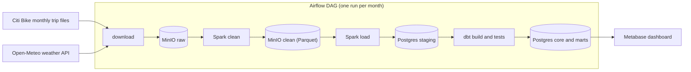
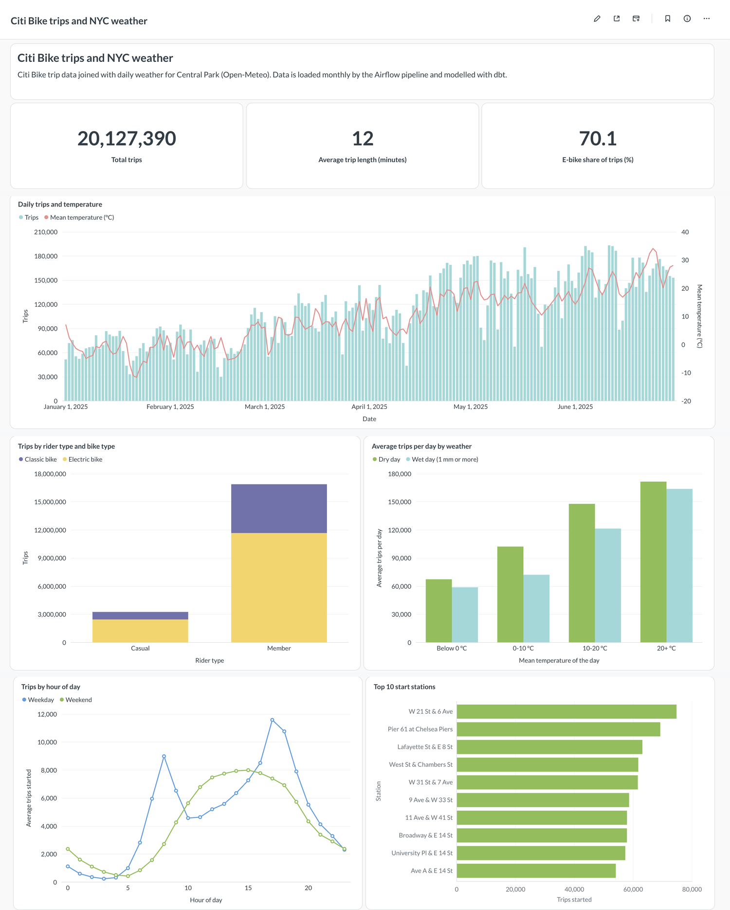

# Citi Bike and Weather Data Pipeline

Final project for DSAI5102 Data Architecture & Engineering.

A monthly batch pipeline that loads New York Citi Bike trips and daily NYC weather, cleans them with Spark, models them in a PostgreSQL warehouse with dbt and shows the results on a Metabase dashboard. Everything runs locally with Docker Compose.

**Question:** how do weather, time of day and location affect bike share use in New York?

## Architecture



| Part | Tool | Why |
|---|---|---|
| Orchestration | Airflow 2.10 | one run per month, retries, backfill of past months |
| Data lake | MinIO (community image `pgsty/silo`) | S3-compatible storage that runs locally; the official MinIO images were removed from Docker Hub in September 2026 |
| Processing | Spark 3.5 (master + 2 workers) | cleaning and loading millions of trips per month |
| Warehouse | PostgreSQL 16 | fits the data size, works with dbt and Metabase |
| Modelling | dbt | star schema and dashboard tables in SQL, with tests |
| Dashboard | Metabase | BI tool that runs in Docker |

## Data

- [Citi Bike System Data](https://citibikenyc.com/system-data): one zip file per month with every trip (start/end time, stations, coordinates, bike type, member or casual rider).
- [Open-Meteo Historical Weather API](https://open-meteo.com/en/docs/historical-weather-api): daily temperature, precipitation, snowfall and wind for Central Park. No API key needed.

By default the pipeline loads January to June 2025.

## Pipeline steps

DAG `citibike_weather_pipeline` (schedule: monthly):

1. `create_buckets`: creates the `raw` and `clean` buckets in MinIO.
2. `download_trips`: downloads the month's zip, unzips it and uploads the CSV files to `raw/citibike/<month>/`.
3. `download_weather`: gets the month from Open-Meteo and saves the JSON to `raw/weather/<month>.json`.
4. `spark_clean`: fixes types, removes duplicates and bad trips (under 1 minute, over 24 hours, started outside the month), adds duration, distance, date and hour, and writes Parquet to `clean/trips/month=<month>/` and `clean/weather/month=<month>/`.
5. `spark_load_warehouse`: deletes the month from the staging tables and loads it again, so a re-run does not create duplicates.
6. `dbt_build`: builds the core and marts tables and runs the tests.
7. `publish_dashboard`: creates the Metabase dashboard through the Metabase API (first run only).

## Warehouse model

| Schema | Table | Grain |
|---|---|---|
| staging | `trips`, `weather` | loaded by Spark |
| core | `fact_trips` | one row per trip, indexed on date and start station |
| core | `dim_date` | one row per day, with the weather of that day |
| core | `dim_station` | one row per station, with name and location |
| marts | `mart_daily_rides`, `mart_rider_mix`, `mart_hourly_usage`, `mart_weather_impact`, `mart_station_usage` | small tables for the dashboard |

## Dashboard

With January to June 2025 loaded (20.1 million trips from 2,337 stations), the six monthly runs took about 13 minutes on a MacBook M3 Pro.



## How to run

You need Docker Desktop with at least 8 GB of memory for Docker (10 GB is better) and about 15 GB of free disk.

```bash
git clone https://github.com/m0d9/citibike-weather-pipeline.git
cd citibike-weather-pipeline
docker compose up -d --build
```

The first build takes a while because it downloads the images and the Spark jars.

1. Open Airflow at http://localhost:8082 and log in with admin / admin.
2. Turn on the DAG `citibike_weather_pipeline`. It runs once for each month from January to June 2025, one month after the other.
3. When the runs are done, open Metabase at http://localhost:3000 and log in with admin@citibike.local / Citibike-Admin-2025. The dashboard is called "Citi Bike trips and NYC weather".

To run one month only, without turning on the schedule:

```bash
docker compose exec airflow-scheduler airflow dags test citibike_weather_pipeline 2025-02-15 -c '{"month": "2025-02"}'
```

| Service | Address | Login |
|---|---|---|
| Airflow | http://localhost:8082 | admin / admin |
| Spark master | http://localhost:8080 | |
| MinIO console | http://localhost:9001 | minioadmin / minioadmin |
| Metabase | http://localhost:3000 | admin@citibike.local / Citibike-Admin-2025 |
| Warehouse (Postgres) | localhost:5433, database `warehouse` | dw / dw |

Settings like the months to load are listed in `.env.example`. Copy it to `.env` to change them.

To stop everything: `docker compose down` (add `-v` to also delete the data).

## Project structure

```
airflow/      Dockerfile (Airflow + Java + PySpark + dbt) and the DAG
spark/        Dockerfile (Spark + S3 and Postgres jars) and the Spark jobs
warehouse/    init.sql: staging schema and tables
dbt/          dbt project: core (facts and dimensions) and marts models, tests
metabase/     setup_dashboard.py: creates the dashboard through the Metabase API
```
